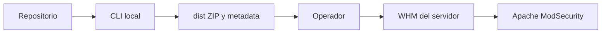

# Arquitectura

## Objetivo

Separar reglas, validación, artefacto y operación para que un error de empaquetado no se confunda con un cambio en un servidor.

## Audiencia

Quien vaya a extender la CLI o el ruleset.

## Prerrequisitos

Python 3.11+ y el árbol del repositorio.

## Límites de confianza

La CLI no cruza hacia WHM. El operador es el límite: solo él, con aprobación, pega la URL en `modsec_vendor add`.

## Flujo de un artefacto

1. El manifiesto y la política eligen reglas en producción.
2. El empaquetador arma `hostium/*.conf` con timestamps fijos.
3. Relee el ZIP y calcula MD5, SHA512 y un SHA-256 propio.
4. Escribe `meta_hostium.yaml` con la versión del motor como clave string.

## Módulos

| Módulo | Responsabilidad |
| --- | --- |
| `validation.py` | Esquema, ids, SecLang prohibido en el paquete |
| `packaging.py` | ZIP reproducible y verificación |
| `metadata.py` | Contrato de `meta_hostium.yaml` |
| `fleet.py` | Comandos remotos de una lista fija, solo lectura |
| `deployment.py` / `rollback.py` | Planes. `apply` lanza error bloqueado |
| `publishing.py` | Orden atómico descrito, sin red |

## Decisiones

El vendor nativo de WHM evita editar el RPM de CRS. Las exclusiones no van en el ZIP porque el orden del proveedor no está garantizado. Ver `docs/ADR/0001-proveedor-nativo-whm.md`.

## Riesgos

Un ZIP con `../` o un symlink queda rechazado por `inspect_zip`. Una metadata con `report_url` también: no hay receptor.

## Verificación

`package verify` compara los hashes releídos. Dos builds seguidos deben coincidir byte a byte en la misma máquina y el mismo Python.

## Deshacer

No sobrescribir `dist/releases/hostium-<version>.zip` si los bytes cambian. Subí la versión.

## Problemas frecuentes

Si el build dice que la versión ya existe, no borres el ZIP a mano para “destrabar” una release ya compartida. Generá otra versión.

## Referencias

Tutorial de vendor de cPanel, enlazado en `docs/REFERENCIAS.md`.

## Limitaciones

No hay firma que WHM valide. El canal stable/canary es una convención de URLs.
