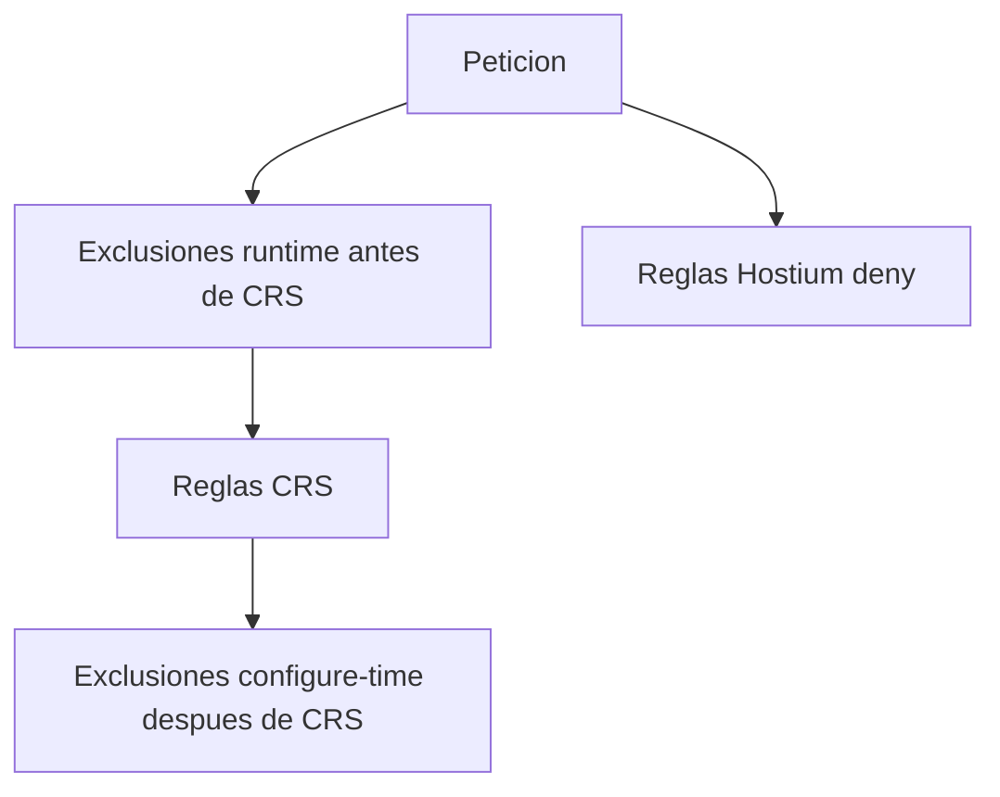

# Falsos positivos y excepciones

## Objetivo

Sacar una regla del camino de una petición concreta sin apagar OWASP ni el vendor entero.

## Audiencia

Soporte y seguridad de plataforma.

## Prerrequisitos

El id, el dominio, la ruta y, si aplica, el parámetro. La guía de CRS sobre el orden de las exclusiones.

## Orden

`ctl:ruleRemoveById` tiene que correr antes de la regla CRS que quiere anular. `SecRuleRemoveById` y `SecRuleUpdateTargetById` se declaran después de que CRS ya fue incluido. El ZIP de Hostium no es el lugar de esas directivas: WHM no promete que el vendor cargue antes o después de OWASP3. Comprobalo con `httpd -t -D DUMP_INCLUDES`.

Las reglas Hostium de esta versión hacen `deny` por su cuenta. No suman al anomaly score de CRS. Una exclusión de un id 9xxxxx de CRS no apaga 5500100. Si hay que exceptuar la nuestra, el id es 5500100 o 5500101, con el mismo cuidado de orden respecto de nuestro include.

## Datos de cada excepción

Id de la excepción, tipo `runtime` o `configure-time`, id de la regla objetivo, alcance, motivo, owner, ticket, fecha de revisión y una prueba negativa que demuestre el caso legítimo. `config/exclusions.example.yaml` está vacío a propósito. La validación rechaza una fecha que no sea `AAAA-MM-DD`.

## PHP upload progress, 1.1.0

La excepción se hace por id, con fecha de revisión. No se edita el ZIP.

| Id | Cuándo molesta |
| --- | --- |
| 5500601 | Un multipart legítimo que llegue con `Transfer-Encoding: chunked` |
| 5500603 | Un formulario con 40 o más niveles de corchetes |
| 5500605 | Un POST con 300 archivos o más |
| 5500613 | Una aplicación que manda `PHPSESSID` como campo porque no usa solo cookies |
| 5500614 | Cualquier cuerpo con `<?php`. No niega; si el log estorba, se saca el id |
| 5500615 | Un POST con 500 partes `form-data` o más |
| 5500617 | Un `PHPSESSID` de respuesta de más de 200 caracteres |
| 5500619 | Una barra de progreso real. No niega |
| 5500621 | Un id de cookie fuera de `[A-Za-z0-9,-]` o de más de 256 caracteres |

`5500614` se dejó en `pass` a propósito. El resto de la tabla que niega se exceptúa con el id, no apagando el vendor, si el caso legítimo está identificado.

## WordPress y WooCommerce

No hay regla activa. Cuando exista, tiene que dejar pasar login, REST, `admin-ajax.php`, carrito y checkout de prueba. No se documenta aquí un `SecRuleRemoveById` global de CRS para “arreglar WordPress”.

## Procedimiento

1. SOLO LECTURA: reproducí en un dominio de prueba y anotá el id.
2. Escribí la excepción con vencimiento. MODIFICA la configuración del dominio o el include de excepciones, no el RPM de CRS.
3. SOLO LECTURA: la petición legítima ya no muestra ese id. La petición maliciosa del mismo control sigue mostrándolo si la excepción fue estrecha.
4. Al vencimiento, revisá o borrala.

## Deshacer

Quitar la excepción y recargar en la ventana acordada. Si el problema es masivo, el rollback del vendor está en el documento 14 y es preferible a deshabilitar CRS.

## Problemas frecuentes

Una excepción `allow` global. El empaquetador rechaza `allow` dentro de un `.conf` que vaya al ZIP. No la agregues en otro include sin una justificación y una prueba de que no abre el resto de CRS.

## Referencias

https://coreruleset.org/docs/2-how-crs-works/2-3-false-positives-and-tuning/

## Limitaciones

No hay un catálogo de exclusiones de producción. La lista vacía es el estado real.
