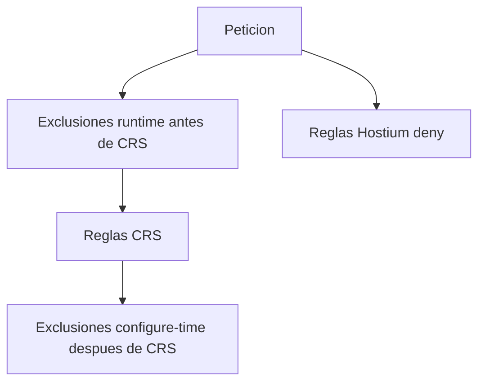

# Falsos positivos y excepciones

## Objetivo

Sacar una regla del camino de una petición concreta sin apagar OWASP ni el vendor entero.

## Audiencia

Soporte y seguridad de plataforma.

## Prerrequisitos

El id, el dominio, la ruta y, si aplica, el parámetro. La guía de CRS sobre el orden de las exclusiones.

## Orden

Un `ctl` de fase 1 queda en la transacción y alcanza una regla CRS de fase 2 aunque el Include de hostium vaya después. `ctl:ruleRemoveById` y `SecRuleRemoveById` siguen fuera del ZIP. `SecRuleUpdateActionById` se resuelve al leer la configuración: si hostium entra antes de OWASP3, `httpd -t` falla y no hay que recargar. Comprobalo con `httpd -t -D DUMP_INCLUDES` en el servidor. Este repositorio no lo corrió.

Las reglas Hostium de `REQUEST-410` hacen `deny` por su cuenta. No suman al anomaly score de CRS. Una exclusión de un id 9xxxxx de CRS no apaga un id 5500. `5500100` y `5500101` no están en el ZIP. Si hay que exceptuar una regla que sí se instala, el id es el de Hostium.

## Datos de cada excepción

Id de la excepción, tipo `runtime`, URI, controles de objetivo, id de la regla CRS, alcance, motivo, owner, ticket si existe, fecha de revisión y una prueba negativa. El catálogo que genera el conf es `config/exclusions.yaml`. `config/exclusions.example.yaml` sigue vacío. La validación rechaza una fecha que no sea `AAAA-MM-DD`, `/login` y una IP.

## Catálogo de hostium-2.1.0

`rules render-exclusions` escribe `REQUEST-900-CRS-EXCLUSIONS.conf`. Cada regla es fase 1, `pass`, `nolog` y una cadena sobre `REQUEST_URI`. El `ctl` está en el segundo eslabón: en ModSecurity 2 un `ctl` del starter corre aunque la cadena no cierre. El cuerpo del POST no está en fase 1, así que el JPEG, el HTML, el `||` y el `stdClass` son el motivo, no la condición.

| Id | URI | Objetivo que deja de mirar |
| --- | --- | --- |
| 5500900 | Empieza con `/aplicacion_customs/xqempresas/aceptar.php` | `ARGS:firmadatos` en 941130 y 941170. El valor legítimo es un JPEG `data:image/jpeg;base64,/9j/`. Ticket `2026-11-02-siga-xqempresas-aceptar`. Revisión 2027-05-02 |
| 5500901 | `/admin` más un token y `/sell/catalog/products/` | `ARGS` en 941100, 941110, 941120, 941130, 941140, 941160, 941170 y 941180. El frente y el resto del backoffice conservan esas reglas |
| 5500902 | Empieza con `/server20200601/mod/contabilidad/multisel_cuentacont.php` | `ARGS:vseleccionados` en 942100. El valor es una lista de cuentas unida con dos barras verticales |
| 5500903 | Empieza con `/aplicacion_customs/marketingdirecto/recibepostturnero.php` | `ARGS:datos` en 933170. El valor es un `stdClass` serializado |

`rules render-score` escribe `REQUEST-910-CRS-ANOMALY-SCORE.conf` desde los cinco conf de CRS 3.3.10 guardados en `third_party/`. Esos archivos no entran al ZIP. El RPM `3.3.10-1.2.1.cpanel` no se diffé. Cada directiva resta `tx.critical_anomaly_score` y suma `tx.warning_anomaly_score` sobre la misma `tx.anomaly_score_plN`. Neto 3. Una sola no llega al umbral 5 de 949110. Dos reglas de 911, 922, 932, 934 o 944 suman 6 y siguen cortando. 920, 921, 930, 931, 933, 941, 942 y 943 quedan en 5. `tx.rce_score` y `tx.lfi_score` no se tocan. El id `5500910` documenta el archivo y no es una `SecRule`.

El caso que motivó el puntaje es un POST multipart a `/login` con nombres de parte como `_1_$action_1`, regla 922130. `/login` no se exceptúa. Un POST `text/plain` de esa misma ruta lo sigue cortando 920420. No se midió CSF ni se observó el caso en cPanel. `ultima_validacion` sigue vacía.

Siguen prohibidos en todo el ZIP: `SecRuleRemoveById`, `ctl:ruleRemoveById`, `allow`, `SecRuleEngine Off` y `ctl:ruleEngine=Off`. El `ctl` de objetivo solo se admite en REQUEST-900. `SecRuleUpdateActionById` solo en REQUEST-910, y cada línea tiene que restar el crítico y sumar el warning.

## PHP upload progress, 1.1.0

La excepción se hace por id, con fecha de revisión. No se edita el ZIP.

| Id | Cuándo molesta |
| --- | --- |
| 5500601 | Un multipart legítimo que llegue con `Transfer-Encoding: chunked` |
| 5500603 | Un formulario con 40 o más niveles de corchetes |
| 5500605 | Un POST con 300 archivos o más |
| 5500613 | Una aplicación que manda `PHPSESSID` como campo porque no usa solo cookies |
| 5500614 | Cualquier cuerpo con `<?php`. No niega; si el log estorba, se saca el id |
| 5500615 | Quinientas partes sin `name` útil. Un formulario de campos con nombre no entra |
| 5500617 | Un `PHPSESSID` de respuesta de más de 200 caracteres |
| 5500619 | Una barra de progreso real. No niega |
| 5500621 | Un id de cookie fuera de `[A-Za-z0-9,-]` o de más de 256 caracteres |

`5500614` se dejó en `pass` a propósito. El resto de la tabla que niega se exceptúa con el id, no apagando el vendor, si el caso legítimo está identificado.

## WordPress y WooCommerce

No hay regla activa. Cuando exista, tiene que dejar pasar login, REST, `admin-ajax.php`, carrito y checkout de prueba. No se documenta aquí un `SecRuleRemoveById` global de CRS para “arreglar WordPress”.

## Procedimiento

1. SOLO LECTURA: reproducí en un dominio de prueba y anotá el id.
2. Escribí la excepción con vencimiento. MODIFICA la configuración del dominio o el include de excepciones, no el RPM de CRS.
3. SOLO LECTURA: la petición legítima ya no muestra ese id. La petición maliciosa del mismo control sigue mostrándolo si la excepción fue estrecha.
4. Al vencimiento, revisá o borrala.

## Deshacer

Quitar la excepción y recargar en la ventana acordada. Si el problema es masivo, el rollback del vendor está en el documento 14 y es preferible a deshabilitar CRS.

## Problemas frecuentes

Una excepción `allow` global. El empaquetador rechaza `allow` dentro de un `.conf` que vaya al ZIP. No la agregues en otro include sin una justificación y una prueba de que no abre el resto de CRS.

## Referencias

https://coreruleset.org/docs/2-how-crs-works/2-3-false-positives-and-tuning/

## Limitaciones

El catálogo de producción es el de la tabla de arriba. Una sola regla crítica de 920, 921, 930, 931, 933, 941, 942 o 943 sigue sumando 5. Si la paranoia sube de 1, 942120 puede marcar el `||` de las cuentas. No se amplía sin un id de log. `ultima_validacion` sigue vacía.
